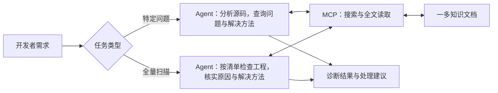

# 一多知识库设计

## 1. 目标与架构

为开发者和 Agent 提供一多适配知识，支持两种任务：

- **特定问题处理**：已有留白、遮挡、黑屏等现象，结合源码查询相关问题和解决方法，核实原因后按开发者要求处理。
- **全量问题扫描**：尚不知道工程有哪些问题，先读取对应框架的审查清单，再按页面和批次检查源码，核实后形成问题清单。

两种任务共用设备档案、通用规则和问题方案。问题文档注明适用框架和版本，说明需要修改页面、原生组件还是鸿蒙宿主（承载 H5、RN、Flutter 等页面的鸿蒙原生工程）。

沿用鸿蒙开发者知识 MCP，通过 Header `scenename: multiDevice` 指定场景。知识库提供检查依据和解决方法，Agent 结合源码分析并按开发者要求处理。



两种任务均由 Agent 执行，MCP 只返回资料，不扫描源码，也不自动读取链接中的内容。自建文档如何入库、按场景查询和发布更新，仍需与服务方确认并联调。

检索索引由云端服务维护，本方案不另建向量库或手工检索索引。自定义 MD 的入库与更新方式仍需服务方确认，现有两个查询工具不负责上传。

## 2. 本地知识与文档组织

### 2.1 本地 Skill 的知识组织

本节只分析 UI、Camera、H5、RN、Flutter 五个领域 Skill。下表路径均相对于各 Skill 根目录。

| Skill | 本地实际结构 | 内容分工 |
|---|---|---|
| UI | `references/scenarios.md`、`references/scenarios/`、`domains/`、`references/cases/`、`assets/` | 索引按六个领域定位现象；场景文档已有“现象—根因—解决方案—实施资料”表；`domains` 解释问题原因、相关机制和 API 用法，案例提供分析及正反例，`assets` 提供代码示例。设备表、布局策略、高保真规则另有专题文件 |
| Camera | `SKILL.md` 按问题现象分类的入口表、`references/camera-*.md`、`references/cases/`、`assets/CameraFoldable.ets` | 专题分别说明相机能力、折展切换、输出流、帧数据、预览与窗口方向；根因索引用于辅助排查，案例和示例补充具体写法。`references/device-capabilities.md` 提供公开规格，不能代替运行时能力查询 |
| H5 | `SKILL.md` 场景入口、`references/` 专题、`assets/responsive-shell/` | 先确认是否提供网页源码、ArkTS 宿主源码或两者；尺寸单位说明区分动态 REM、插件换算和普通 CSS 尺寸。专题说明组件、页面、媒体、键盘、窗口变化及宿主联动，兼容性与排障资料按需补读 |
| RN | `SKILL.md` 场景入口、`references/`、`references/adaptive-components/`、`references/recipe-index.md`、`assets/recipes/` | 先确认框架版本，以及问题出在 JS 页面、Host、TurboModule 还是 Fabric 组件，再检查窗口尺寸传递到组件的过程。组件资料说明可直接使用、需要封装适配或仅供参考；recipe 是带使用条件的代码模板 |
| Flutter | `core/`、`scenarios/`、`flutter-native/`、`hadss/`、`ohos-platform/`、`validation/`、`references/`、`examples/` | 基本规则、场景说明、实现方式、宿主相关能力及验收资料分别维护；Flutter 原生组件与 HADSS 是两种可选实现，OHOS 平台方案可与其中任一种配合。详细参考资料按需读取，代码示例按实现方式分开 |

领域知识与必要代码示例可以入库；本地 `SKILL.md` 保留支持范围、修改约束和知识查询方法。执行流程、运行脚本、开发回归用例及任务产物不作为知识内容入库。

### 2.2 知识覆盖范围

知识按问题主题整理，技术框架作为具体判断和实施的条件，不把五个 Skill 直接当作五类知识。

| 主题 | 覆盖内容 |
|---|---|
| 设备信息 | 型号、屏幕、使用形态、参考尺寸、相机配置及能力限制 |
| 尺寸与基本规则 | 屏幕、窗口和容器的区别，单位换算、横纵断点及布局选择 |
| 布局适配 | 导航、列表、表单、弹窗、轮播等结构，伸缩、换行、滚动、图片比例和内容密度 |
| 安全区与键盘避让 | 系统栏、挖孔、圆角、窗口装饰、沉浸式、软键盘、自定义键盘及重复避让 |
| 方向与旋转 | 自然方向、窗口方向、显示旋转、方向声明、临时横屏及退出恢复 |
| 窗口形态 | 全屏、分屏、悬浮窗、自由窗口、动态缩放、窗口事件与生命周期 |
| 折叠形态与折痕 | 折展、悬停、帐篷态、折痕分区，以及路由、输入、滚动和播放状态连续性 |
| 主题、国际化与无障碍 | 深浅色、大字体、长文本、RTL，以及重排后的读屏和焦点顺序 |
| 相机 | 能力查询、设备选择、折展切镜、会话恢复、预览与 Surface、旋转镜像、拍照录像输出及帧数据 |

当前统一范围为直板机、折叠屏和平板。各主题按框架实际覆盖情况整理，不因旧资料包含相关词条就扩大到 PC/2in1 或其他能力。

### 2.3 本地资料的归属

沿用“发现问题—确认原因—选择修法”的组织方式，不单设“技术原理与实现”。

| 本地资料 | 整理后的归属 |
|---|---|
| 场景、基本规则和已有检查项 | 按框架形成审查清单，写清检查对象、适用条件、判断依据和排除情况 |
| 设备规格及能力参考 | 进入设备档案，不代替运行时能力查询 |
| `scenarios`、根因及专项排障资料 | 进入问题与方案，保留同一现象的不同原因和区分方法 |
| `domains`、各框架专题、`core` 中的机制与 API 说明 | 并入对应问题的原因分析和解决方案；跨框架共用概念进入通用规则 |
| `cases`、`assets`、recipe、Flutter 示例及局部复验方法 | 放入对应问题，说明代码使用条件、版本和验证情况；不再平行建立案例库或代码库 |

### 2.4 问题文档的内容

每篇按“问题现象 → 适用条件 → 原因与判断依据 → 解决方案 → 必要代码与注意事项 → 修复后检查”组织，单篇即可理解基本修法，不要求先跳转到另一类文档才能看懂。

“问题”也包括宽屏增列、导航挪移、悬停分区等适配需求，不仅是故障。需要改变页面结构时，区分已有设计、待确认方案和确定性缺陷。

代码与正反例优先放在正文；较长且可复用的方案可在同一领域独立成篇，按内容引用。来源、适用版本和核验记录用于维护，不另建一套测试标准。

## 3. 知识范围与目录

知识分为设备档案、通用规则、审查清单、问题与方案四类。问题与方案先按领域、再按实际需要区分框架；机制说明、API、代码和案例都服务于具体问题，不单列一级目录。执行流程、运行脚本和任务状态不放入知识库。

以下目录用于组织和维护文档，Agent 不需要逐级读取目录。无需另建全库、设备或领域的 `索引.md`，直接通过云端搜索定位文档，按需读取全文和相关方案。

以下为目标目录，问题文件用于说明组织方式：

```text
one-multi/
├── 设备档案/
│   ├── 直板机/
│   ├── 常规折叠/
│   ├── 阔折叠/
│   ├── 小折叠/
│   ├── 三折叠/
│   └── 平板/
├── 通用规则/
│   ├── 设备分类与形态.md
│   ├── 尺寸单位与断点.md
│   ├── 窗口与容器约束.md
│   ├── 自适应与响应式布局选择.md
│   └── 窗口变化与业务状态连续性.md
├── 审查清单/
│   ├── 原生ArkTS工程.md
│   ├── H5工程.md
│   ├── RN工程.md
│   ├── Flutter工程.md
│   └── 相机专项.md
└── 问题与方案/
    ├── 布局适配/
    │   ├── ArkUI/
    │   │   ├── 固定尺寸导致内容截断.md
    │   │   └── 导航意外分栏导致主页窄条.md
    │   ├── H5/
    │   │   ├── 动态REM导致宽屏整体放大.md
    │   │   └── Web容器与网页尺寸不同步.md
    │   ├── RN/
    │   │   ├── 窗口变化后样式未刷新.md
    │   │   └── RNSurface与窗口尺寸不同步.md
    │   └── Flutter/
    │       ├── 固定约束导致内容溢出.md
    │       └── 窗口变化后布局与状态异常.md
    ├── 安全区与键盘避让/
    ├── 方向与旋转/
    ├── 窗口形态/
    ├── 折叠形态与折痕/
    ├── 主题、国际化与无障碍/
    └── 相机/
```

目录与正文的分工：

- **审查清单**按框架提供可直接对照源码的检查内容、判断依据和排除情况；相机提供专项清单。清单用于发现候选问题，不以搜索返回的几条结果代替完整检查范围。
- **问题与方案**包含现象、适用条件、原因、处理方法、必要代码及修复后检查。多根因问题在正文说明如何区分，不能把一个症状固定绑定一种修法。
- **设备档案**按系列合并，同代标准版、Pro 等型号用表格对照；平板同产品、同尺寸的不同年份分行记录。共同内容只写一次，型号、版本和来源逐项对应；跨代或形态差异明显的设备保留独立档案，不合并参数。
- **通用规则**维护跨框架共用的概念和判断依据，不重复收录各框架的 API 细节。

标题、框架、适用条件和来源需写入文档，不能只靠文件夹名说明。每篇讲清一个主题，保留必要前提和完整的解决方法，无关主题不合并。

设备及单位概念沿用[设备分类与形态](公共规则/设备分类与形态.md)和[尺寸单位与断点](公共规则/尺寸单位与断点.md)。不能仅凭设备类型决定页面布局，参考尺寸也不能代替实际窗口数据。

### 3.1 三方框架的组织方式

H5、RN、Flutter 沿用相同的问题领域，但分别维护审查清单和具体方案。只为已有知识建立框架目录，不要求每个领域补齐四套。

| 框架 | 问题文档中的重点 |
|---|---|
| ArkUI | 父子容器约束、断点状态、栅格、导航、系统窗口和资源配置 |
| H5 | Web 外部尺寸、网页 viewport、CSS、动态 REM 及构建期单位转换 |
| RN | Dimensions、动态样式、Flex/Yoga、Modal/Portal，以及 RNSurface、TurboModule、Fabric 的尺寸与事件传递 |
| Flutter | 父约束、LayoutBuilder、MediaQuery、状态保持，以及 OHOS 宿主与引擎配合；原生组件与 HADSS 按工程现状择一采用 |

共用概念只在通用规则维护，具体 API、数值、依赖和版本限制留在对应框架方案中。相同领域不表示四个框架具备相同能力，也不直接套用 ArkUI 的接口和阈值。

涉及宿主与框架两端修改时，仍归对应框架问题。例如《Web容器与网页尺寸不同步》同时说明 ArkTS 和 H5 各自如何测量、传递和更新尺寸，不另建“宿主与跨层协同”目录。相机目录按已有相机链路知识整理，不据此宣称提供三方框架相机 SDK 的完整适配。

## 4. 文档格式与方案关联

### 4.1 使用普通 Markdown

- **一级标题**：写清问题、技术主题、设备系列或独立机型，便于搜索，不再重复填写标题字段。
- **适用条件与正文**：写清适用的框架和版本、需要检查或修改的代码、判断依据和处理方法，不能只打标签。
- **来源与核验日期**：保留在正文，区分已核实结论、示例和待验证内容。

文档标识由云端入库服务管理，读取时使用搜索返回的 `parent`，不要求作者手写文档 ID。`multiDevice` 场景由入库配置统一指定，来源路径、发布及更新记录由系统管理，具体支持方式需服务方确认。后续确有筛选需要时再增加字段，当前不要求作者填写。

需要配合其他方案时，在正文写清对应问题或方案的标题、适用框架和使用条件。Agent 按需再次搜索该标题并用 `parent` 读取，不能把文件路径或链接直接当作文档标识。

### 4.2 问题条目样例

以下为写法示例，正式发布前需核实适用版本，并补充来源和验证证据：

```markdown
# H5固定内容宽度导致展开后留白

## 问题

展开后内容仍保持窄屏宽度。已确认该区域应扩展，不是详情正文限宽。

## 环境

HarmonyOS WebView 内嵌 H5，可修改网页源码；列出已核验版本和复现条件。

## 原因与判断依据

窗口、Web容器和网页视口均已变宽，内容容器仍受固定宽度限制。
若 Web 容器本身未变宽，应检查 ArkTS 宿主中的容器布局，不能只改 CSS。

## 解决方法

对已确认应占满父容器、且父容器宽度已确定的块级内容，移除固定像素宽度，
使用 `width: 100%; box-sizing: border-box;`，核对内边距及子元素。
若父级采用 Flex，还需核对空间分配和收缩约束，不强套同一写法。
不因此修改工程原有的尺寸单位，也不取消合理的详情正文限宽。
较长的共用代码可另查《H5容器宽度自适应》，基本解决方法仍保留在本篇。

## 验证与来源

在原问题窗口和窄屏下复验，并检查折展后页面、输入和操作状态是否保持，核对内容及操作区域。
记录来源、适用版本、核验日期和证据。
```

### 4.3 同一现象的不同原因和解决方法

同一现象可能有多种原因，需要结合源码和运行结果确认，不能仅凭关键词选择解决方法。例如“展开后留白”：

| 判断依据 | 可能原因 | 修改位置 |
|---|---|---|
| 父容器变宽，子内容不变 | 固定尺寸或限宽 | 对应框架组件 |
| 导航模式与栏位不符合已确认布局 | 意外分栏 | 导航层 |
| Web 容器本身未变宽 | 宿主容器尺寸未更新 | ArkTS，必要时同时修改 H5 |
| RN 窗口数据已变，样式未变 | 派生样式未刷新 | RN JS |
| 窗口变宽，RNSurface 未跟随 | 宿主未将尺寸变化同步给 RNSurface | RNOH Host |

同一页面可能同时存在多个原因。方案需说明属于哪种关系：

- **择一使用**：如 Flutter 原生组件与 HADSS，根据工程现状选择，不默认引入新依赖。
- **配合使用**：如 ArkTS 调整容器、H5 按可用区域调整网页，两端共同修改。
- **独立修复**：如父容器限宽与子元素固定宽度同时存在，分别处理。

涉及框架与宿主配合时，写清由哪端提供数据、哪端使用，以及单位、事件和初始化、更新、释放时机；只有一端源码时，说明还需要开发者提供或修改哪些代码。对应问题文档保留使用条件、步骤、代码和检查方法，多个问题复用同一方案，不复制正文。

## 5. Agent 查询与使用

两种任务均通过 `searchDocuments` 查找资料，用返回的 `parent` 读取所需全文，不先读取纯文件清单。区别是：特定问题结合源码定向查询；全量扫描先读取审查清单，不能等发现问题后才查知识。

### 5.1 特定问题处理

例如 ArkUI 展开后留白：先检查目标页面及父容器、固定尺寸和导航，再以“ArkUI＋展开留白＋源码中的可疑约束”搜索。读取问题全文，按判断依据确认原因，再采用文中的方案和必要代码；需要共用概念时补读通用规则。已有内容足够时不再补读，证据不足时不下结论，不能因为搜到相似问题就认定原因相同。

### 5.2 全量问题扫描

接入后按以下方式使用知识：

1. Agent 先分析源码框架、页面及公共依赖，确定审查范围；结构扫描本身不等于发现全部适配问题。
2. 搜索并读取对应框架的审查清单全文。混合工程同时核对清单涉及的宿主代码，涉及相机取流时补读相机专项。
3. Agent 按清单检查当前范围的源码，区分适用、不适用、需要实际运行才能确认的检查项；已读且仍在上下文中的共用规则直接复用，不逐页重复检索。
4. 对可能的问题查询具体方案，核实位置、条件和原因后形成问题清单。优化建议与已确认的问题分开记录，不能把所有固定尺寸或未增列都报成问题。

审查清单直接提供检查依据，例如：

| 检查对象 | 核查内容 | 排除或限制 |
|---|---|---|
| 内容容器 | 固定宽高、父容器约束及滚动设置是否在目标窗口造成留白、截断或无法操作 | 图标、按钮或业务合理限宽不能仅因固定尺寸就判错 |
| Navigation | 默认或显式设置的模式是否在宽屏产生非预期分栏，主页和详情是否符合业务设计 | 已确认的分栏不能直接取消，默认行为需结合 SDK 核实 |
| Tabs | 导航位置随窗口调整时，相关布局属性是否同时更新，切回窄屏是否恢复，选中状态是否保留 | 不因窗口变宽就默认要求所有页面改为侧栏 |
| 键盘与安全区 | 窗口、容器和页面是否重复避让，输入框与操作按钮是否可见、可操作 | 需要实际运行才能确认的效果保留待验证，不凭源码猜测 |

清单根据现有场景、规则和检查资料整理，不另建测试标准。不能只读搜索返回的少数片段就宣布完成全量审查；缺少清单或某项无法检查时，说明哪些内容尚未检查。一次 MCP 搜索不保证找到全部规则，任务如何分批和执行仍由调用方流程负责，本文不展开。

设备参数查询和新增能力实现按需读取相关档案或方案，不强行套入故障诊断。API 结合工程 SDK、框架版本和官方资料核对；不猜机型参数，也不把编译成功当作运行通过。

## 6. MCP 接入

沿用[鸿蒙开发者知识 MCP](https://developer.huawei.com/consumer/cn/doc/start/hosknowledgemcp-0000002664603963)的“搜索 → 全文读取”，不新增工具。

### 6.1 Header

```http
POST https://connect-api.cloud.huawei.com/api/developerknowledge/mcp
Content-Type: application/json
Accept: application/json, text/event-stream
scenename: multiDevice
```

鉴权沿用服务机制，`scenename` 只指定查询场景，不是鉴权凭证，也不要求在每篇 MD 中重复填写。

### 6.2 搜索与全文读取（GridRow 实测）

2026-11-03，通过当前 MCP 连接搜索 GridRow 并读取全文，两次均返回成功。以下返回示例为业务 JSON，省略外层协议封装，`content` 已截短。

**搜索请求：**

```json
{
  "jsonrpc": "2.0",
  "id": 1,
  "method": "tools/call",
  "params": {
    "name": "searchDocuments",
    "arguments": {
      "SearchDocumentsReq": {
        "query": "ArkUI GridRow breakpoints 断点",
        "topK": 1
      }
    }
  }
}
```

**搜索返回：**

```json
{
  "code": 0,
  "message": "success",
  "resultList": [
    {
      "parent": "alliance/document/cn/harmonyos-references/ts-container-gridrow",
      "content": "参数名: callback 类型: (breakpoints: string) => void …"
    }
  ]
}
```

`content` 是命中的文本片段；`parent` 是该片段所属整篇文档的资源标识，不是本地父目录或网页地址。

**全文请求：** 将 `parent` 原值放入 `names`。场景接入时，搜索和全文读取应保持相同 Header。

```json
{
  "jsonrpc": "2.0",
  "id": 2,
  "method": "tools/call",
  "params": {
    "name": "getDocumentsById",
    "arguments": {
      "GetDocumentsByIdRequest": {
        "names": ["alliance/document/cn/harmonyos-references/ts-container-gridrow"]
      }
    }
  }
}
```

**全文返回：**

```json
{
  "code": 0,
  "message": "success",
  "resultList": [
    {
      "name": "alliance/document/cn/harmonyos-references/ts-container-gridrow",
      "title": "GridRow",
      "uri": "https://developer.huawei.com/consumer/cn/doc/harmonyos-references/ts-container-gridrow",
      "content": "# GridRow\n\n…其余正文省略…"
    }
  ]
}
```

本次取得约 1.5 万字符的完整 Markdown。字段对应关系为：`搜索结果.parent → 全文请求.names[] → 全文结果.name`；`uri` 才是来源网页地址。同一文档的多个片段可能具有相同 `parent`，去重后读取一次即可。

`id` 是 JSON-RPC 请求编号，与文档标识无关。全文读取最多 10 个文档，按需读取。本次未单独验证 `scenename: multiDevice` 的服务端分流效果。

### 6.3 服务端配合

| 配合事项 | 要求 |
|---|---|
| 场景与访问 | 搜索、全文及缓存均区分场景，允许读取相关官方资料；未找到资料时明确说明 |
| 入库与关联 | 支持普通 MD 更新，保留标题、来源和引用；由服务管理文档标识并转换本地链接，不要求作者补一套自定义字段 |
| 分块与读取 | 解决方法保留适用环境、版本和限制；片段不完整时可补读章节或全文 |
| 更新发布 | 文档更新后由云端服务同步检索索引，保持正文与关联一致；失效内容指向有效版本 |

现有查询工具不承担写入。具体分块、过滤和发布方式由服务方实现，本方案不替换检索平台。

## 7. 职责分工与知识维护

### 7.1 职责分工

| 位置 | 保留内容 |
|---|---|
| Agent 与领域 Skill | 保留支持范围、修改约束和查询方法；分析源码、查阅资料、核实问题并按开发者要求处理 |
| 知识库 | 设备档案、通用规则、审查清单、问题与方案；原因说明、代码示例和修复后检查包含在对应问题中 |
| 调用方流程与工具 | 任务控制、执行、验证及结果管理，本文不展开 |

不上传执行脚本、任务运行状态、账号、密钥或未经脱敏的数据。测试标准引用维护团队确认的内容，并注明适用对象与版本，不另设与原标准冲突的阈值，也不修改原测试工具或规则。

### 7.2 知识更新与维护

维护方式参考 [KCS（以知识为中心的服务）](https://library.serviceinnovation.org/KCS/KCS_v6/KCS_v6_Practices_Guide/030)，优先复用和修订已有知识，确实缺少再新增。

| 遇到的情况 | 处理方式 |
|---|---|
| 已有文档适用 | 直接复用，不重复新建 |
| 条件或版本不完整 | 补充原文档的适用环境、版本或限制 |
| 发现新原因或不同解决方法 | 核实后修订原文档；需要独立说明时新增文档并引用相关问题 |
| 原方案失效 | 修订或注明替代方案，更新相关引用和云端检索索引 |

Agent 提供问题证据和修订建议，维护人员核实、脱敏后发布。不将一次修复结果自动转为公共知识，也不要求每个任务新增文档。

更新顺序：收集资料或反馈 → 核实并修订 → 更新入库文档 → 检查 MCP 查询结果 → 发布；查询结果不正确则继续修订。

新机上市或规格变化时更新设备信息，根据 SDK、框架版本变化和已验证的问题处理经验更新方案。保留来源、核验日期和适用版本；未核实的内容明确标注，旧方案注明替代文档。知识是否最新取决于文档维护和云端索引更新，MCP 不会自动补充新知识。

## 8. 后续整理

先按上述结构整理本地知识清单，核对重复内容、适用框架和版本，再确定迁移范围与顺序。设备档案沿用现有内容，本地 Skill 的支持范围、修改约束和执行配置保留。
