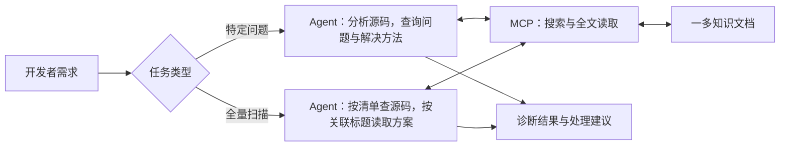
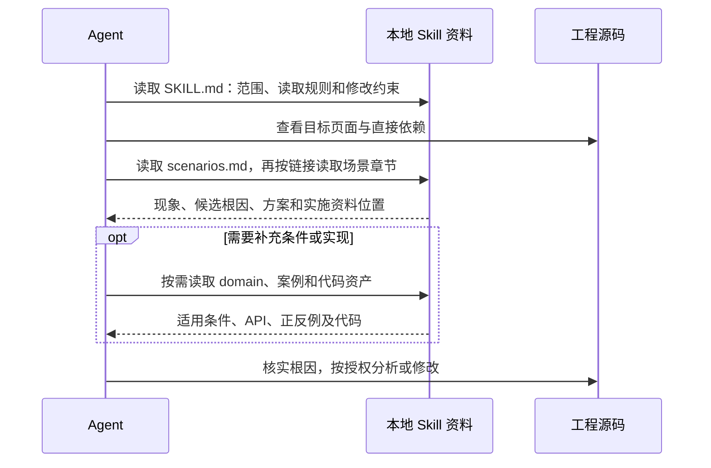
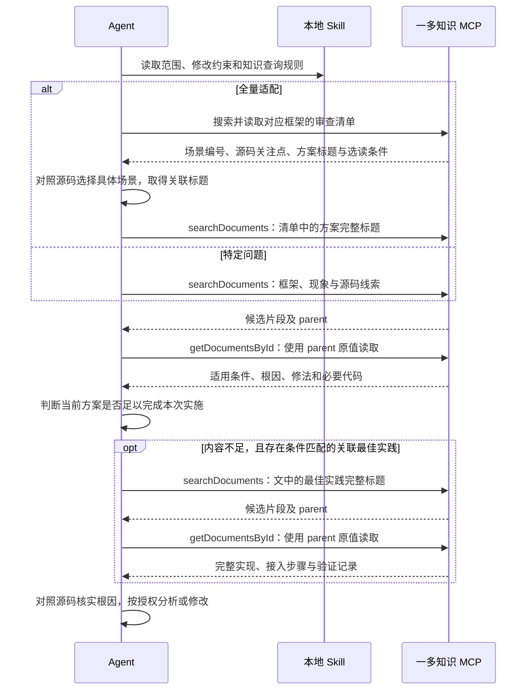

# 一多知识库设计

## 1. 目标与架构

为开发者和 Agent 提供一多适配知识，支持两种任务：

- **特定问题处理**：已有留白、遮挡、黑屏等现象，结合源码查询相关问题和解决方法，核实原因后按开发者要求处理。
- **全量问题扫描**：尚不知道工程有哪些问题，先读取对应框架的审查清单，再按页面和批次检查源码，核实后形成问题清单。

两种任务共用设备档案、公共规则、适配原则、问题方案和最佳实践。清单中的每条具体场景关联方案完整标题及选读条件，Agent 据此搜索正文。问题方案解释原因和基本修法；当这些内容不足以完成当前实施，且文章关联了适用的最佳实践时，Agent 再读取完整实现，不将最佳实践作为每次必读项。

沿用鸿蒙开发者知识 MCP，通过 Header `scenename: one-multi` 指定场景。知识库提供检查依据和解决方法，Agent 结合源码分析并按开发者要求处理。



两种任务均由 Agent 执行。MCP 只返回资料，不扫描源码、不自动追读关联文章，也不依据场景编号自动选择修法。

检索索引由云端服务维护，本方案不另建向量库或手工检索索引。自定义 MD 的入库与更新方式仍需服务方确认，现有两个查询工具不负责上传。

## 2. 本地知识与文档组织

### 2.1 本地 Skill 的知识组织

本节只分析 UI、Camera、H5、RN、Flutter 五个领域 Skill。下表路径均相对于各 Skill 根目录。

| Skill | 本地实际结构 | 内容分工 |
|---|---|---|
| UI | `references/scenarios.md`、`references/scenarios/`、`domains/`、`references/cases/`、`assets/` | 索引按六个领域定位现象；场景文档已有“现象—根因—解决方案—实施资料”表；`domains` 解释问题原因、相关机制和 API 用法，案例提供分析及正反例，`assets` 提供代码示例。设备表、布局策略、高保真规则另有专题文件 |
| Camera | `SKILL.md` 按问题现象分类的入口表、`references/camera-*.md`、`references/cases/`、`assets/CameraFoldable.ets` | 专题分别说明相机能力、折展切换、输出流、帧数据、预览与窗口方向；根因索引用于辅助排查，案例和示例补充具体写法。`references/device-capabilities.md` 提供公开规格，不能代替运行时能力查询 |
| H5 | `SKILL.md` 场景入口、`references/` 专题、`assets/responsive-shell/` | 先确认是否提供网页源码、ArkTS 宿主源码或两者；尺寸单位说明区分动态 REM、插件换算和普通 CSS 尺寸。专题说明组件、页面、媒体、键盘、窗口变化及宿主联动，兼容性与排障资料按需补读 |
| RN | `SKILL.md` 场景入口、`references/`、`references/adaptive-components/`、`references/recipe-index.md`、`assets/recipes/` | 先确认框架版本，以及问题出在 JS 页面、Host、TurboModule 还是 Fabric 组件，再检查窗口尺寸传递到组件的过程。组件资料说明可直接使用、需要封装适配或仅供参考；recipe 是带使用条件的代码模板 |
| Flutter | `core/`、`scenarios/`、`flutter-native/`、`hadss/`、`ohos-platform/`、`validation/`、`references/`、`examples/` | 基本规则、场景说明、实现方式、宿主相关能力及验收资料分别维护；Flutter 原生组件与 HADSS 是两种可选实现，OHOS 平台方案可与其中任一种配合。详细参考资料按需读取，代码示例按实现方式分开 |

领域知识与必要代码示例可以入库；本地 `SKILL.md` 保留支持范围、修改约束和知识查询方法。执行流程、运行脚本、开发回归用例及任务产物不作为知识内容入库。

### 2.2 知识覆盖范围

知识按问题主题整理，技术框架作为具体判断和实施的条件，不把 Skill 名称直接当作知识分类。

| 主题 | 覆盖内容 |
|---|---|
| 设备信息 | 型号、屏幕、使用形态、参考尺寸、相机配置及能力限制 |
| 基础概念与约定 | 设备分类与形态，屏幕、窗口和容器的区别，单位换算及横纵断点 |
| 总体适配原则 | 如何分配可用宽高、选择增列或重排方式，以及折展、旋转和分屏后如何保持业务状态 |
| 布局适配 | 导航、列表、表单、弹窗、轮播等结构，伸缩、换行、滚动、图片比例和内容密度 |
| 安全区与键盘避让 | 系统栏、挖孔、圆角、窗口装饰、沉浸式、软键盘、自定义键盘及重复避让 |
| 方向与旋转 | 自然方向、窗口方向、显示旋转、方向声明、临时横屏及退出恢复 |
| 窗口形态 | 全屏、分屏、悬浮窗、自由窗口、动态缩放、窗口事件与生命周期 |
| 折叠形态与折痕 | 折展、悬停、帐篷态、折痕分区，以及路由、输入、滚动和播放状态连续性 |
| 主题、国际化与无障碍 | 深浅色、大字体、长文本、RTL，以及重排后的读屏和焦点顺序 |
| 相机 | 能力查询、设备选择、折展切镜、会话恢复、预览与 Surface、旋转镜像、拍照录像输出及帧数据 |

当前统一范围为直板机、折叠屏和平板。各主题按框架实际覆盖情况整理，不因旧资料包含相关词条就扩大到 PC/2in1 或其他能力。

### 2.3 本地资料的归属

沿用“发现问题—确认原因—选择修法”的组织方式，不单设“技术原理与实现”。

| 本地资料 | 整理后的归属 |
|---|---|
| `scenarios.md` 等场景入口 | 按框架整理场景编号、场景、典型现象、源码关注点及对应方案；同一问题类型下的不同现象分别关联，不另加源码判错与验证标准 |
| 设备规格及能力参考 | 进入设备档案，不代替运行时能力查询 |
| 设备分类、单位和断点定义 | 进入公共规则，统一术语、单位和取值口径 |
| 跨框架的空间分配、布局选择和状态保持方法 | 进入适配原则，不与基础概念混放 |
| 场景详解、根因及专项排障资料 | 进入问题与方案，保留同一现象的不同原因和区分方法 |
| `domains`、各框架专题、`core` 中的机制与 API 说明 | 并入对应问题的原因分析和解决方案；不单独建立技术原理分类 |
| `cases`、`assets`、recipe、Flutter 示例中的局部修法 | 放入对应问题，说明代码使用条件、版本和验证情况，不另建零散案例库或代码库 |
| 完整且验证过的页面、组件或组合实现 | 整理为最佳实践，说明接入步骤、完整代码及验证记录，由问题文章按条件关联 |

### 2.4 问题文档的内容

每篇按“问题现象 → 适用条件 → 原因与判断依据 → 解决方案 → 必要代码与注意事项 → 修复后检查”组织，单篇即可理解基本修法，不要求先跳转到另一类文档才能看懂。

“问题”也包括宽屏增列、导航挪移、悬停分区等适配需求，不仅是故障。需要改变页面结构时，区分已有设计、待确认方案和确定性缺陷。

必要代码与正反例保留在正文；跨多个问题或领域的完整实现归入独立的“最佳实践”分类。问题文章通过“相关最佳实践”说明完整标题、何时补读及适用条件。基本方案已足够时直接使用，没有适用实践时不额外查找。

## 3. 知识范围与目录

知识分为设备档案、公共规则、适配原则、审查清单、问题与方案、最佳实践六类。问题与方案按领域和框架解释具体问题与修法；最佳实践按框架和页面或组件类型组织，提供可复用的完整实现，可组合布局、避让和状态保持等多个领域。执行流程、运行脚本和任务状态不放入知识库。

以下目录用于组织和维护文档，Agent 不需要逐级读取目录。无需另建全库、设备或领域的 `索引.md`，直接通过云端搜索定位文档，按需读取全文和相关方案。

以下为目标目录，未整理的框架和最佳实践文件名仅用于说明组织方式，不代表已有对应文章：

```text
one-multi/
├── 设备档案/
│   ├── 直板机/
│   ├── 常规折叠/
│   ├── 阔折叠/
│   ├── 小折叠/
│   ├── 三折叠/
│   └── 平板/
├── 公共规则/
│   ├── 设备分类与形态.md
│   └── 尺寸单位与断点.md
├── 适配原则/
│   └── 一多适配总体原则.md
├── 审查清单/
│   ├── 原生ArkTS工程.md
│   ├── H5工程.md
│   ├── RN工程.md
│   ├── Flutter工程.md
│   └── 相机专项.md
├── 问题与方案/
│   ├── 布局适配/
│   │   ├── ArkUI/
│   │   │   ├── 父子尺寸约束与滚动内容截断.md
│   │   │   └── Navigation意外分栏与路由页面空白.md
│   │   ├── H5/
│   │   │   ├── 动态REM导致宽屏整体放大.md
│   │   │   └── Web容器与网页尺寸不同步.md
│   │   ├── RN/
│   │   │   ├── 窗口变化后样式未刷新.md
│   │   │   └── RNSurface与窗口尺寸不同步.md
│   │   └── Flutter/
│   │       ├── 固定约束导致内容溢出.md
│   │       └── 窗口变化后布局与状态异常.md
│   ├── 安全区与键盘避让/
│   ├── 方向与旋转/
│   ├── 窗口形态/
│   ├── 折叠形态与折痕/
│   ├── 主题、国际化与无障碍/
│   └── 相机/
└── 最佳实践/
    ├── ArkUI/
    │   ├── 多设备商品列表页.md
    │   └── 短窗口表单与键盘避让.md
    ├── H5/
    ├── RN/
    └── Flutter/
```

目录与正文的分工：

- **审查清单**按框架列出稳定场景编号、场景、典型现象、源码关注点，以及对应方案标题和选读条件；相机提供专项清单。具体根因、判定依据和修法归入问题与方案，出现某个属性不等于存在缺陷。
- **问题与方案**包含现象、适用条件、原因、处理方法、必要代码及修复后检查。多根因问题在正文说明如何区分，不能把一个症状固定绑定一种修法。
- **最佳实践**提供完整页面或组件的可复用实现，包括接入条件、步骤、代码及验证记录。记录须区分构建、设备运行与交互检查，未验证部分如实说明，不能把构建通过写成所有设备效果通过。它补充问题方案，不重复复制诊断正文，也不把零散片段直接标成完整实践。
- **设备档案**按系列合并，同代标准版、Pro 等型号用表格对照；平板同产品、同尺寸的不同年份分行记录。共同内容只写一次，型号、版本和来源逐项对应；跨代或形态差异明显的设备保留独立档案，不合并参数。
- **公共规则**统一设备分类、形态、尺寸单位和断点的含义，不规定页面如何排列。
- **适配原则**集中在《一多适配总体原则》中，说明父子容器怎样分配空间、何时伸缩或重排、窗口变化后保留哪些状态，不提供各框架的具体 API 修法。

标题、框架和适用条件需写入文档，不能只靠文件夹名说明。每篇讲清一个主题，保留必要前提和完整的解决方法，无关主题不合并。最佳实践可能组合多个领域，因此按框架和页面或组件类型组织，不再强行拆到六个问题领域。

设备及单位概念沿用[设备分类与形态](公共规则/设备分类与形态.md)和[尺寸单位与断点](公共规则/尺寸单位与断点.md)。不能仅凭设备类型决定页面布局，参考尺寸也不能代替实际窗口数据。

### 3.1 三方框架的组织方式

H5、RN、Flutter 沿用相同的问题领域，但分别维护审查清单和具体方案。只为已有知识建立框架目录，不要求每个领域补齐四套。

| 框架 | 问题文档中的重点 |
|---|---|
| ArkUI | 父子容器约束、断点状态、栅格、导航、系统窗口和资源配置 |
| H5 | Web 外部尺寸、网页 viewport、CSS、动态 REM 及构建期单位转换 |
| RN | Dimensions、动态样式、Flex/Yoga、Modal/Portal，以及 RNSurface、TurboModule、Fabric 的尺寸与事件传递 |
| Flutter | 父约束、LayoutBuilder、MediaQuery、状态保持，以及 OHOS 宿主与引擎配合；原生组件与 HADSS 按工程现状择一采用 |

共用概念在公共规则维护，整体布局和状态保持方法在适配原则维护；具体 API、数值、依赖和版本限制留在对应框架方案中。相同领域不表示四个框架具备相同能力，也不直接套用 ArkUI 的接口和阈值。

涉及宿主与框架两端修改时，仍归对应框架问题。例如《Web容器与网页尺寸不同步》同时说明 ArkTS 和 H5 各自如何测量、传递和更新尺寸，不另建“宿主与跨层协同”目录。相机目录按已有相机链路知识整理，不据此宣称提供三方框架相机 SDK 的完整适配。

## 4. 文档格式与方案关联

### 4.1 文档格式与查询标题

入库知识使用 Markdown，沿用现有的 YAML 头部：`title`、`summary`、`createdAt`、`updatedAt`，正文从 `Overview 总体概述` 说明用途。`title` 是清单关联和搜索使用的完整标题，在库内保持唯一；正文另有一级标题时与它一致。

适用框架、版本、原因和使用条件写在正文，不靠元数据代替。更新日期不代表运行验证日期；代码片段与已验证实现应如实区分，不要求正文追加来源链接。来源及修订过程通过仓库和发布记录维护。

文档标识由云端服务管理，读取时使用搜索返回的 `parent` 原值，不手写文档 ID、不把本地路径当作远程标识。`one-multi` 场景由入库配置和请求 Header 指定，不在每篇 MD 重复填写。

### 4.2 场景如何对应方案

关系直接维护在各框架的审查清单中，不另建重复的对应表。原生清单每行包含五列：

| 字段 | 用途 |
|---|---|
| 场景编号 | 稳定标识这一条具体场景，调整顺序不重新编号；不是 MCP 查询参数，也不是任务 Issue ID |
| 场景 | 保留“留白、截断、遮挡”等分类，便于浏览；同名分类不能代替具体场景 |
| 典型现象 | 区分同类问题的具体表现 |
| 源码关注点 | 指出应检查的属性、容器、事件或配置，不直接判错 |
| 对应方案与选读条件 | 填写方案的完整 `title`；关联多篇时说明各自适用条件，必要时指出文章中的章节 |

例如，下面两项都属于留白，但不应使用同一泛化搜索词代替关联：

| 场景编号 | 典型现象 | 对应方案与选读条件 |
|---|---|---|
| ARK-LAYOUT-029 | 展开后主页挤在左栏，右侧为空，或已确认分栏的区域未铺满 | 《ArkUI Navigation 宽屏主页变窄、右栏空白与跳转白屏》；先区分意外 Auto 与已确认双栏，再读对应方案分支 |
| ARK-LAYOUT-025 | 自定义键盘在展开态右侧、底部留白，或面板过高 | 《ArkUI 自定义键盘在宽屏右侧留白、底部空隙或面板过高》；分别核对内部宽度、剩余高度和面板总高 |

允许一条场景关联多篇方案，也允许多条场景共用一篇；文章内仍须核实原因，不能把它的全部分支套到同一场景。场景编号首次按领域分配，新增时使用该领域新编号，不因插入、排序或改名重排已有编号。原生领域前缀分别为 `ARK-LAYOUT`、`ARK-SAFE`、`ARK-FOLD`、`ARK-ROT`、`ARK-PREF`、`ARK-WIN`。

对应关系以清单为准，问题文章不再重复维护场景编号列表。方案改名、拆分或删除时，同步更新清单中的所有引用；尚无适用方案时明确写“暂无对应方案”，不能硬挂相似文章充当覆盖。

### 4.3 同一现象的不同原因和解决方法

同一现象可能有多种原因，需要结合源码和运行结果确认，不能仅凭关键词选择解决方法。例如“展开后留白”：

| 判断依据 | 可能原因 | 修改位置 |
|---|---|---|
| 父容器变宽，子内容不变 | 固定尺寸或限宽 | 对应框架组件 |
| 导航模式与栏位不符合已确认布局 | 意外分栏 | 导航层 |
| Web 容器本身未变宽 | 宿主容器尺寸未更新 | ArkTS，必要时同时修改 H5 |
| RN 窗口数据已变，样式未变 | 派生样式未刷新 | RN JS |
| 窗口变宽，RNSurface 未跟随 | 宿主未将尺寸变化同步给 RNSurface | RNOH Host |

同一页面可能同时存在多个原因。方案需说明属于哪种关系：

- **择一使用**：如 Flutter 原生组件与 HADSS，根据工程现状选择，不默认引入新依赖。
- **配合使用**：如 ArkTS 调整容器、H5 按可用区域调整网页，两端共同修改。
- **独立修复**：如父容器限宽与子元素固定宽度同时存在，分别处理。

涉及框架与宿主配合时，写清由哪端提供数据、哪端使用，以及单位、事件和初始化、更新、释放时机；只有一端源码时，说明还需要开发者提供或修改哪些代码。对应问题文档保留使用条件、步骤、代码和检查方法，多个问题复用同一方案，不复制正文。

### 4.4 最佳实践的关联

关联入口放在问题文章的“相关最佳实践”章节，不在审查清单中再维护一份实践列表。一篇问题文章可按条件关联多篇实践，一篇实践也可供多个问题复用。

| 关联内容 | 写法与用途 |
|---|---|
| 最佳实践完整标题 | 使用目标文章的 `title`，供 Agent 搜索；不填写本地路径或猜测的远程标识 |
| 何时补读 | 写明当前方案不足以支持哪类实施，例如缺少完整页面结构、接入步骤或多个能力的组合实现 |
| 适用条件 | 写明框架、版本、既有结构及必要依赖，供 Agent 判断是否匹配当前工程 |

Agent 完整读取问题文章后，先判断现有内容能否满足任务：足够时直接采用；不足且存在条件匹配的关联实践时，按完整标题调用 `searchDocuments`，再用返回的 `parent` 调用 `getDocumentsById`。读取后核对适用条件，再采用需要的实现，不自动扩大修改范围。

问题文章仍保留基本修法，最佳实践补充完整实现，不重复正文。没有适用实践时不额外搜索整库，也不猜测不存在的文章；未整理的实践不写空引用。实践改名、拆分或删除时，同步更新引用它的问题文章。

## 5. Agent 查询与使用

以下以原生 ArkTS/ArkUI 为例，对比本地读取与知识上云后的读取。全量任务在分批前可按需读取设备、工程和结构约束，深入排查时再按批次使用场景与方案；局部问题直接围绕目标页面处理。两张图只说明知识读取，不改变调用方流程。

### 5.1 当前：本地 Skill 读取

场景索引给出本地文件位置，Agent 按需继续读取，不要求每次读完所有 domain、案例和资产。



### 5.2 上云后：按场景与方案关系读取

以下为清单、方案及对应关系发布后的目标流程。当前只完成本地知识整理，尚未发布这些文章或切换 Skill 读取入口。



场景类型用于分类，场景编号用于关联；两者都不能代替清单中明确填写的方案标题。完整标题仍是普通搜索词，不保证第一条精确命中。先根据返回片段选候选；响应没有独立标题字段时，读取正文后核对 `title`、框架和适用条件。使用 `parent` 原值读取并按它去重，不截掉 `#0` 等后缀，不拼接资源标识。

同一正文在本次任务中复用，不按场景重复检索。未命中可补充框架和主题重查；仍不匹配、正文不完整或方案未收录时说明缺口，不按相似文章补齐结论。公共规则、适配原则和设备档案按需补读。

### 5.3 特定问题处理

例如 ArkUI 展开后留白：先检查目标页面及父容器、固定尺寸和导航，再以“ArkUI＋展开留白＋源码中的可疑约束”搜索问题文章；必要时查清单确定具体场景和关联标题。读取正文后区分固定尺寸、合理限宽、意外分栏等原因，再采用对应修法。单位或断点不清楚时查公共规则，整体布局选择不清楚时查适配原则。

### 5.4 全量问题扫描

接入后按以下方式使用知识：

1. Agent 先分析源码框架、页面及公共依赖，确定审查范围；结构扫描本身不等于发现全部适配问题。
2. 搜索并读取对应框架的审查清单全文。混合工程同时核对清单涉及的宿主代码，涉及相机取流时补读相机专项。
3. 根据页面结构筛选相关场景，沿源码关注点排查。需要判断是否有问题时，按该行的方案完整标题搜索并读取，结合选读条件查看相关分支；不是发现缺陷后才第一次查判断依据。
4. 对候选问题核实位置、触发条件、原因和方案后形成问题清单；优化建议与已确认缺陷分开。当前方案不足以完成实施，且有条件匹配的关联最佳实践时，再按标题补读；同一文章无需逐页重查。

清单与文章是多对多关系，不要求每个页面存在问题，也不要求 71 条场景对应 71 篇文章。不相关场景按代码结构排除；没有判断依据、对应方案缺失或无法取得全文时，说明未覆盖部分，不能只读少数搜索片段就宣称完成全量审查。任务如何分批和执行仍由调用方流程负责。

设备参数查询和新增能力实现按需读取相关档案或方案，不强行套入故障诊断。API 结合工程 SDK、框架版本和官方资料核对；不猜机型参数，也不把编译成功当作运行通过。

## 6. MCP 接入

沿用[鸿蒙开发者知识 MCP](https://developer.huawei.com/consumer/cn/doc/start/hosknowledgemcp-0000002664603963)的“搜索 → 全文读取”，不新增工具。

### 6.1 地址与 Header

当前内网验证地址如下；发布时由接入环境指定地址，不在每个领域 Skill 复制一份配置。

```http
POST https://lfagccloudgwsdv01cn.hwcloudtest.cn/api/developerknowledge/mcp
Content-Type: application/json
Accept: application/json, text/event-stream
scenename: one-multi
```

鉴权沿用服务机制，`scenename` 只指定查询场景，不是鉴权凭证，也不要求在每篇 MD 中重复填写。

运行环境已配置 MCP 时直接使用工具；插件无法配置 MCP 时，由现有 `harmonyos-knowledge-onemulti` 提供 HTTPS 调用指导。两种接入使用同一组 JSON-RPC 工具，不新增 REST 业务接口，也不要求改知识服务。

### 6.2 搜索与全文读取（GridRow 实测）

2026-11-03，通过当时的 MCP 连接搜索 GridRow 并读取全文，两次均返回成功。以下返回示例为业务 JSON，省略外层协议封装，`content` 已截短。

**搜索请求：**

```json
{
  "jsonrpc": "2.0",
  "id": 1,
  "method": "tools/call",
  "params": {
    "name": "searchDocuments",
    "arguments": {
      "SearchDocumentsReq": {
        "query": "ArkUI GridRow breakpoints 断点",
        "topK": 1
      }
    }
  }
}
```

**搜索返回：**

```json
{
  "code": 0,
  "message": "success",
  "resultList": [
    {
      "parent": "alliance/document/cn/harmonyos-references/ts-container-gridrow",
      "content": "参数名: callback 类型: (breakpoints: string) => void …"
    }
  ]
}
```

`content` 是命中的文本片段；`parent` 是后续读取使用的资源标识，不是本地父目录或网页地址。它可能带分片后缀，应当作不透明字符串原样传递，不能按本地路径规则推导全文地址。

**全文请求：** 将 `parent` 原值放入 `names`。场景接入时，搜索和全文读取应保持相同 Header。

```json
{
  "jsonrpc": "2.0",
  "id": 2,
  "method": "tools/call",
  "params": {
    "name": "getDocumentsById",
    "arguments": {
      "GetDocumentsByIdRequest": {
        "names": ["alliance/document/cn/harmonyos-references/ts-container-gridrow"]
      }
    }
  }
}
```

**全文返回：**

```json
{
  "code": 0,
  "message": "success",
  "resultList": [
    {
      "name": "alliance/document/cn/harmonyos-references/ts-container-gridrow",
      "title": "GridRow",
      "uri": "https://developer.huawei.com/consumer/cn/doc/harmonyos-references/ts-container-gridrow",
      "content": "# GridRow\n\n…其余正文省略…"
    }
  ]
}
```

本次取得约 1.5 万字符的完整 Markdown。字段对应关系为：`搜索结果.parent → 全文请求.names[] → 全文结果.name`；`uri` 才是来源网页地址。同一文档的多个片段可能具有相同 `parent`，去重后读取一次即可。

`id` 是 JSON-RPC 请求编号，与文档标识无关。全文读取最多 10 个文档，按需读取。该实测验证搜索与全文读取，不作为当前 `one-multi` 场景分流的验证结果。

### 6.3 服务端配合

| 配合事项 | 要求 |
|---|---|
| 场景与访问 | 搜索、全文及缓存均区分场景，允许读取相关官方资料；未找到资料时明确说明 |
| 入库与关联 | 支持普通 MD 更新，保留完整标题及正文中的选读条件；文档标识由服务管理，文章关联由 Agent 按标题搜索，不依赖自动转换本地链接 |
| 分块与读取 | 解决方法保留适用环境、版本和限制；片段不完整时可补读章节或全文 |
| 更新发布 | 文档更新后由云端服务同步检索索引，保持正文与关联一致；失效内容指向有效版本 |

现有查询工具不承担写入。具体分块、过滤和发布方式由服务方实现，本方案不替换检索平台。

## 7. 职责分工与知识维护

### 7.1 职责分工

| 位置 | 保留内容 |
|---|---|
| Agent 与领域 Skill | 保留支持范围、修改约束和查询方法；分析源码、查阅资料、核实问题并按开发者要求处理 |
| 知识库 | 设备档案、公共规则、适配原则、审查清单、问题与方案、最佳实践；问题文章说明原因和基本修法，实践补充完整实现 |
| 调用方流程与工具 | 任务控制、执行、验证及结果管理，本文不展开 |

不上传执行脚本、任务运行状态、账号、密钥或未经脱敏的数据。测试标准引用维护团队确认的内容，并注明适用对象与版本，不另设与原标准冲突的阈值，也不修改原测试工具或规则。

### 7.2 知识更新与维护

维护方式参考 [KCS（以知识为中心的服务）](https://library.serviceinnovation.org/KCS/KCS_v6/KCS_v6_Practices_Guide/030)，优先复用和修订已有知识，确实缺少再新增。

| 遇到的情况 | 处理方式 |
|---|---|
| 已有文档适用 | 直接复用，不重复新建 |
| 条件或版本不完整 | 补充原文档的适用环境、版本或限制 |
| 发现新原因或不同解决方法 | 核实后修订原文档；需要独立说明时新增文档并引用相关问题 |
| 方案或实践改名、拆分或失效 | 同步修改清单或问题文章中的相应标题引用，核对选读条件，再更新云端正文与检索内容 |

Agent 提供问题证据和修订建议，维护人员核实、脱敏后发布。不将一次修复结果自动转为公共知识，也不要求每个任务新增文档。

更新顺序：收集资料或反馈 → 核实并修订 → 检查场景映射和标题引用 → 更新入库文档 → 检查 MCP 查询与正文 → 发布。检查每条场景至少有一个适用方案，引用标题存在且唯一，多个分支有选读条件；新增或未覆盖场景如实保留缺口。

新机上市或规格变化时更新设备信息，根据 SDK、框架版本变化和已验证的问题处理经验更新方案。适用版本和限制保留在正文，来源与核验过程由维护记录保存；未核实的内容不写成确定结论。知识是否最新取决于文档维护和云端更新，MCP 不会自动补充新知识。

## 8. 当前产出与接入顺序

当前本地已整理 32 篇设备档案、两篇公共规则、一篇适配原则，以及原生 ArkTS 六领域的 71 条场景和 28 篇问题方案。原生清单已补齐稳定编号、对应方案标题与选读条件；另已整理商品列表和短窗口表单两篇 ArkUI 最佳实践，并在五篇相关问题文章中补齐标题、补读条件与适用条件。两份完整示例通过 API 20 工程构建，设备运行未验证，范围在各篇记录中说明。相机、H5、RN、Flutter 的场景和具体方案后续分别整理，不据此宣称已覆盖。

此次只更新知识仓库，不修改 Skill 或发布云端。后续将清单、对应方案及关联实践成套入库，验证“清单场景 → 方案正文 → 按条件补读最佳实践”，再更新查询 Skill 的知识范围及各领域的读取入口。查询正常后再清理已迁移的本地正文，保留支持范围、修改约束、必要代码资产和执行配置。
